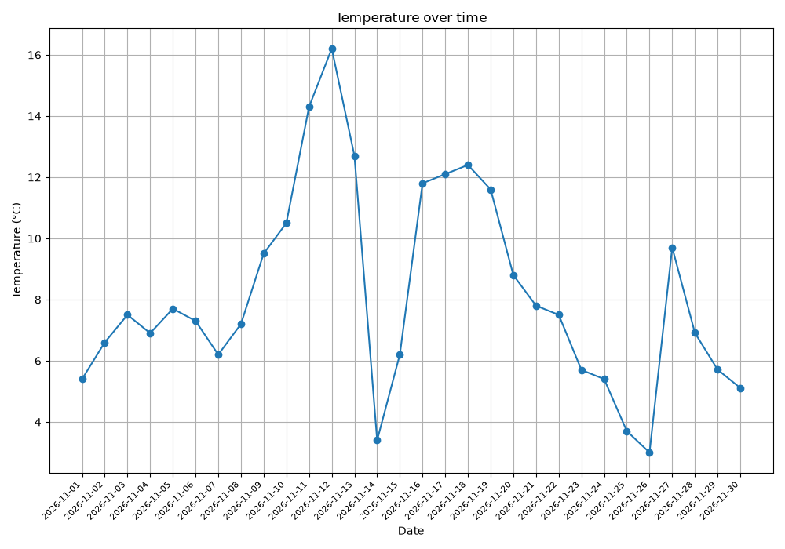
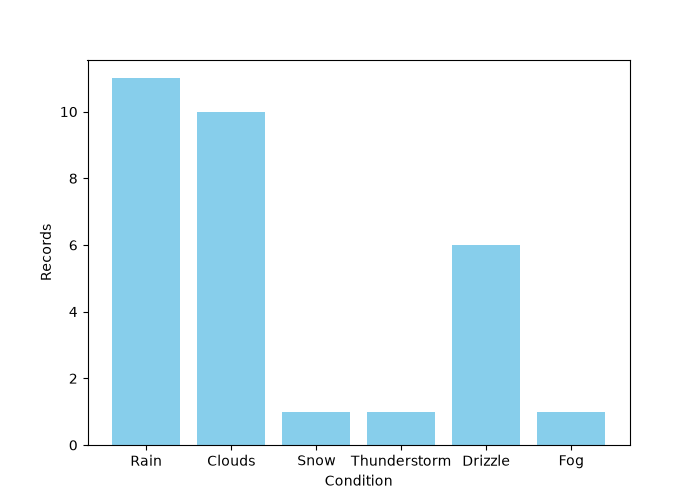

# Day 5: Weather Data Visualization

[Group overview](../README.md) · [Challenge index](../../README.md) · [Main project overview](../../../README.md#folder-overview)

The task is to plot graphs from the weather CSV data. `visualize_weather()` reads `weather_logs.csv` and displays two figures using `matplotlib.pyplot`, imported as `plt`. It reads existing data without calling OpenWeather, loading `.env`, or changing the CSV.

Read the unchanged [original task](DAY_5.md) alongside [day_5.py](day_5.py). Project explanations and updates belong in this README; the original task text is maintained separately.

## Files

| File | Purpose |
| --- | --- |
| `weather_logs.csv` | The visualizer's independent copy of the existing November demonstration dataset. |
| [DAY_5.md](DAY_5.md) | The original weather sample data and instruction to plot graphs. |
| [day_5.py](day_5.py) | Reading weather records and displaying a line plot and condition-frequency bar chart. |
| [temperature_sarajevo_november_2026.png](temperature_sarajevo_november_2026.png) | Manually saved Figure 1: the daily mean temperature series for the November demo. |
| [weather_conditions_sarajevo_november_2026.png](weather_conditions_sarajevo_november_2026.png) | Manually saved Figure 2: condition counts for the same 30 records. |

## Day 5 setup and running

Install Matplotlib with the Python interpreter used to run the project:

```powershell
python -m pip install matplotlib
```

The `csv` and `collections` modules are built into Python and need no installation. If VS Code still reports an unresolved import after installation, check the selected Python interpreter; reloading the window can refresh Pylance.

`FILENAME = Path(__file__).resolve().parent / "weather_logs.csv"` reads the CSV beside `day_5.py`, using its own local CSV snapshot. This works when the terminal is at the repository root or when the file is launched with **Ctrl + S**.

From the repository root:

```powershell
python "challenges/02_data_handling/day_5/day_5.py"
```

The CSV must already exist in `challenges/02_data_handling/day_5`, with `Date`, `City`, `Temperature`, and `Condition` columns. Use its included demonstration data, copy newer Day 4 records using the instructions below, or use the sample data from `DAY_5.md`; keep the original task file unchanged. A missing CSV still raises `FileNotFoundError`; the visualizer reads data and does not create it.

The original relative path searched the terminal's working directory, causing `FileNotFoundError` when saving from VS Code with the terminal at the repository root. Building the path from `__file__` fixes that without changing the terminal directory.

Close the first chart window to let the program continue to the second `plt.show()` call. After closing the second chart, the script finishes.

## Updating Day 5 from Day 4

Day 4 writes `../day_4/weather_logs.csv`; Day 5 reads `weather_logs.csv`. To chart the logger's current records, copy them from the repository root:

```powershell
Copy-Item -LiteralPath "challenges/02_data_handling/day_4/weather_logs.csv" -Destination "challenges/02_data_handling/day_5/weather_logs.csv"
```

This replaces Day 5's current CSV, including its demonstration data. Run `day_5.py` again afterwards. Saved PNGs remain snapshots until you save the charts again through Matplotlib's toolbar.

## Reading data and drawing the figures

1. `csv.DictReader` reads each row as a dictionary. The script converts `Temperature` to `float` before collecting dates in `dates` and numeric values in `temps`. Invalid numeric values or missing fields skip the row before anything is appended.
2. `defaultdict(int)` initializes a missing condition count to zero. `conditions[row["Condition"]] += 1` counts each record for that condition.
3. If there are no collected dates, the script prints `NO data is available` and returns.
4. The first figure uses `plt.plot(dates, temps, marker="o")` to connect entries in file order. Its title is `Temperature over time`, with a temperature axis in degrees Celsius, rotated date labels, a grid, and `tight_layout()` to adjust spacing.
5. The second figure uses `plt.bar(...)` to display condition counts as sky-blue bars. The horizontal axis is labeled `Condition`, and the vertical axis is labeled `Records`.

With the seven sample records in `DAY_5.md`, the condition counts are:

| Condition | Record count |
| --- | --- |
| Clear | 2 |
| Sunny | 2 |
| Rain | 2 |
| Clouds | 1 |

The line plot receives seven entries in the sample's order. Dates are not sorted by the script, and records from different cities are combined. The bar chart counts CSV records rather than unique calendar days. For a dataset with one city and one row per day, these counts also equal the number of days.

## Current behaviour to understand

CSV values start as strings. The original `temps.append(row["Temperature"])` remains as a comment beside the active numeric append. Converting to `float` fixes the temperature axis: values such as `3.0`, `12.0`, and `8.0` are now positioned by their numeric values, rather than their order of first appearance as text categories.

The row-processing handler catches `KeyError`, `TypeError`, and `ValueError` before appending the date, temperature, and condition. Missing files still fail before that block. Figures are displayed in windows; the script does not save image files.

## November 2026 demonstration dataset

The current `weather_logs.csv` contains **30 daily rows for Sarajevo, November 1–30, 2026**, prepared on November 12, 2026 for plotting practice. It retains the original four CSV columns. These are daily mean temperatures in °C, unlike Day 4's individual current-weather readings. The November demo was prepared separately; Day 4 still uses OpenWeather.

**The full month is not an observed historical record.** Data comes from [Open-Meteo](https://open-meteo.com/en/docs), with the final three days simulated for this exercise:

| Dates | Provenance |
| --- | --- |
| November 1–11 | Open-Meteo model values for past dates; not measurements from a weather station. |
| November 12–27 | Open-Meteo forecast daily means as available on November 12. Today's full-day mean is also a forecast. |
| November 28–30 | Simulated demonstration values, not fetched observations or forecasts. |

The API request used Sarajevo coordinates `43.8563, 18.4131`, timezone `Europe/Sarajevo`, `daily=temperature_2m_mean,weather_code`, and dates `2026-11-01` through `2026-11-27`. Daily weather codes describe the day's most severe condition and are grouped into readable labels such as `Clouds`, `Rain`, and `Snow`. [Open-Meteo's daily parameter definitions](https://open-meteo.com/en/docs#daily-parameter-definition) explain these values.

For the simulated final three temperatures, the mean of the last seven forecast temperatures was adjusted by `+0.8`, `-0.4`, and `-1.0` °C, respectively. Their conditions were chosen as `Clouds`, `Rain`, and `Clouds` for demonstration; these are not predictions.

Day 5's working CSV is a plotting demonstration rather than a collection of live observations. The separate Day 4 CSV initially contains the same existing records, and its duplicate check uses the city/date entries in its own file. Later changes to either CSV do not update the other copy automatically.

## Saved chart examples

These PNG files are snapshots saved manually with the disk icon in Matplotlib's toolbar. `Figure 1` and `Figure 2` are window labels, rather than filenames. The Python script displays the figures; it does not save these PNGs automatically or refresh them when the CSV changes.

Both images use the [November 2026 demonstration dataset](#november-2026-demonstration-dataset): past model values, forecasts, and three simulated days. They are not a complete month of observed weather.

**Figure 1: daily mean temperature for Sarajevo**



The horizontal axis shows dates, and the vertical axis shows temperature in °C. The 30 points follow the CSV's day order. This view helps compare warmer and cooler parts of the demonstration month.

**Figure 2: weather condition counts for Sarajevo**



Each bar counts records for one condition. The counts total 30: `Rain` 11, `Clouds` 10, `Snow` 1, `Thunderstorm` 1, `Drizzle` 6, and `Fog` 1. With one Sarajevo record per date, each record represents one day in this demo.

To regenerate the snapshots after changing the data, run `day_5.py`, save the first figure with the disk icon, close it to open the second figure, and save that one too. Use the filenames listed above to update the images displayed in this README.

## How to run

From the repository root:

```powershell
python "challenges/02_data_handling/day_5/day_5.py"
```

Or, from this lesson's folder:

```powershell
python .\day_5.py
```

In VS Code, open `day_5.py` and press **Ctrl + S**. For input prompts, click inside the Run on Save terminal, type your answer, and press **Enter**. Exit an older running instance before starting the moved script.

Complete the [setup instructions](#day-5-setup-and-running) above before running this project.

Input and output paths resolve from this Python file, so data stays in this lesson folder regardless of the terminal's working directory.

## Useful links for beginners

- [Matplotlib quick start](https://matplotlib.org/stable/users/explain/quick_start.html): figures, axes, plotting data, and displaying charts.
- [Matplotlib categorical plotting](https://matplotlib.org/stable/gallery/lines_bars_and_markers/categorical_variables.html): how string values become category labels.
- [Counting with collections.defaultdict](https://docs.python.org/3/library/collections.html#collections.defaultdict): how Day 5's condition counters start at zero with `defaultdict(int)`.
- [Python CSV reading and writing](https://docs.python.org/3/library/csv.html): reading rows and dictionaries, writing records, and handling CSV line endings.
- [Paths with pathlib](https://docs.python.org/3/library/pathlib.html): `Path(__file__).resolve().parent` for keeping input and output beside the script.
- [Open-Meteo daily data](https://open-meteo.com/en/docs): the source used when preparing the model and forecast portion of the November demonstration.

[Previous: Day 4](../day_4/README.md) · [Next: Day 6](../day_6/README.md)
