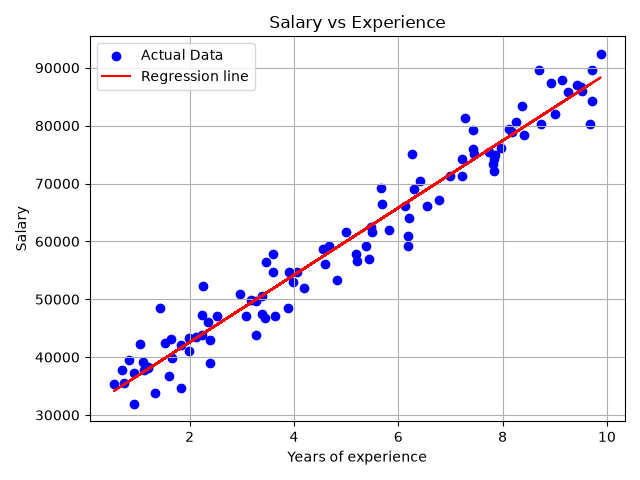

# Day 3: Salary Prediction with Linear Regression

Fit a straight-line model to the synthetic experience/salary data from Day 2, print its slope and intercept, and compare the recorded and predicted values in a Matplotlib chart.

[Data Science overview](../README.md) · [Challenge index](../../README.md) · [Main project overview](../../../README.md#folder-overview)

## Setup and running

Install the packages with the Python interpreter used to run this project:

```powershell
python -m pip install pandas matplotlib scikit-learn
```

The package is installed as **`scikit-learn`** but imported as **`sklearn`**:

```python
from sklearn.linear_model import LinearRegression
```

From the repository root, first run Day 2 if its CSV is missing, then run Day 3:

```powershell
python "challenges/05_data_science/day_2/day_2.py"
python "challenges/05_data_science/day_3/day_3.py"
```

Or open `day_3.py` in VS Code and press **Ctrl + S** with the existing Run on Save setup. The terminal shows the model parameters, and a separate chart window opens. Close the chart window when finished.

## Input and file locations

The input is [Day 2's generated CSV](../day_2/experience_salary.csv), with columns `YearsExperience` and `Salary`. The script reads this shared file directly:

```text
05_data_science/
├── day_2/
│   ├── day_2.py
│   └── experience_salary.csv
└── day_3/
    ├── day_3.py
    ├── DAY_3.md
    ├── README.md
    └── salary_vs_experience_linear_regression.png
```

`DATA_FILE` is built from `Path(__file__).resolve()`, so running from the repository root or the lesson folder uses the same CSV. No duplicate input file is needed in `day_3`.

The `PredictedSalary` column is added to the DataFrame in memory. Day 3 does not overwrite the input CSV, export predictions, save the fitted model, or automatically save an image. Matplotlib's chart window can be used to save a figure manually.

## How the code works

1. `pd.read_csv(DATA_FILE)` loads the table generated by Day 2.
2. `X = data[["YearsExperience"]]` keeps the input as a two-dimensional DataFrame: one row per record, with one feature column.
3. `y = data["Salary"]` selects a one-dimensional Series for the single value the model learns to predict.
4. `LinearRegression()` creates the model, and `model.fit(X, y)` fits a line to the available records.
5. `model.predict(X)` returns one predicted salary per row, stored in `data["PredictedSalary"]`.
6. `model.coef_[0]` supplies the slope, and `model.intercept_` supplies the intercept.
7. Matplotlib displays blue data points and a red fitted line, along with labels, a legend, and a grid.

The fitted relationship is:

```text
predicted salary = intercept + slope × years of experience
```

The slope represents the model's estimated salary change for one additional year of experience. The intercept is the fitted line's value at zero years of experience.

With the currently generated Day 2 data, the verified terminal output is:

```text
Model Coefficient (slope) 5806.58
Model Intercept (base salary) 30956.39
```

These values depend on the input CSV. This lesson fits and predicts on the same synthetic records; it does not yet use a separate test set or report prediction accuracy on unseen data.

## Saved chart example

[salary_vs_experience_linear_regression.png](salary_vs_experience_linear_regression.png) is a manually saved example from the Matplotlib window. Blue points show the synthetic salary records from Day 2, while the red line shows the fitted model's predictions. The horizontal axis represents years of experience, and the vertical axis represents salary.



To save another example, use the save button in the chart window and choose a filename inside `day_3`. The script itself does not automatically export this image.

## Local fixes and import troubleshooting

The initial `ModuleNotFoundError` occurred because scikit-learn was not installed in the terminal's Python environment. Install it using the command above. If Pylance still cannot resolve the import, use **Python: Select Interpreter** to select the environment where it was installed. Run `python -c "import sys; print(sys.executable)"` in the terminal to identify that interpreter; reload the VS Code window if the diagnostic remains stale.

Two small code adjustments also make the supplied example work in this repository:

- The original relative CSV filename followed the terminal's current directory. `DATA_FILE` now points explicitly to the CSV in `day_2`.
- The supplied target selection used `data[["Salary"]]`, making the target and coefficients two-dimensional. Selecting `data["Salary"]` gives a single-target model whose coefficient and intercept can be converted to scalar numbers by the existing print statements. This avoids array-to-scalar conversion errors with the installed NumPy version.

If the CSV is missing, run Day 2 to generate it before starting Day 3.

## Task description provenance

`DAY_3.md` was authored locally from the supplied script at the repository owner's request because no original task description was provided. Preserve that statement during later documentation updates.

## Useful links and package source

- [Linear regression — Wikipedia](https://en.wikipedia.org/wiki/Linear_regression): background reading on the method used in this lesson.
- [scikit-learn documentation](https://scikit-learn.org/stable/): the official machine learning library documentation.
- [LinearRegression reference](https://scikit-learn.org/stable/modules/generated/sklearn.linear_model.LinearRegression.html): the model, fitting, prediction, and learned coefficients used here.
- [scikit-learn — GitHub](https://github.com/scikit-learn/scikit-learn): the official source repository, available to star.
- [pandas](https://pandas.pydata.org/): reading and working with the CSV table.
- [Matplotlib quick start](https://matplotlib.org/stable/users/explain/quick_start.html): plotting data and fitted values.
