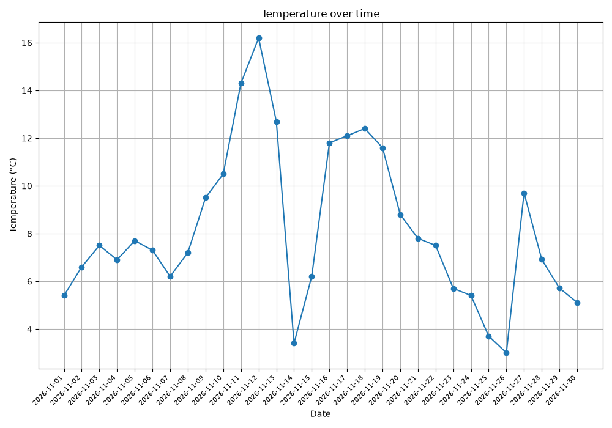
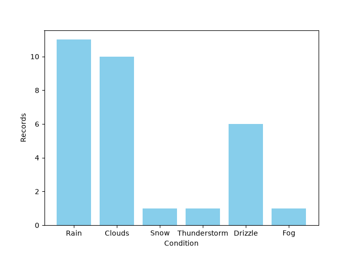

# Challenges — Days 12–21

This is the second challenge group. Work through it after [day 1–11](../day%20%5B1-11%5D/README.md), then continue with the later groups in the [challenge index](../README.md#challenge-groups).

**Status: in progress.** Local days 1–8 are documented. The weather logger supports adding and viewing records; its requested summary statistics are not implemented yet.

Navigate through the [challenge index](../README.md) or return to the [main project overview](../../README.md#folder-overview).

## Learning order and file numbering

1. Read the [original Day 1 challenge](DAY_1.md), then explore [day_1.py](day_1.py).
2. Read the [original Day 2 challenge](DAY_2.md), then explore [day_2.py](day_2.py).
3. Read the [original Day 3 challenge](DAY_3.md), then explore [day_3.py](day_3.py).
4. Read the [original Day 4 challenge](DAY_4.md), complete the [weather logger setup](#day-4-setup-openweather-and-env), then explore [day_4.py](day_4.py).
5. Read the [original Day 5 sample data](DAY_5.md), then follow the [visualization setup](#day-5-setup-and-running) and explore [day_5.py](day_5.py).
6. Read the [original Day 6 challenge](DAY_6.md), then explore [day_6.py](day_6.py) with the included [sample JSON](api_data.json).
7. Read the [original Day 7 challenge](DAY_7.md), then explore [day_7.py](day_7.py) with the [sample CSV](raw_data.csv).
8. Read the [original Day 8 challenge](DAY_8.md), then explore [day_8.py](day_8.py) and its [nested JSON example](nested_data.json).
9. Continue with later local projects in numerical order as they are added.
10. After this group, continue with `day [22-31]` and the remaining challenge groups before returning to the next numbered course section (`12_...`).

The tutorial restarts project numbering in this folder: `DAY_1.md` and `day_1.py` belong to `day [12-21]` and are separate from the files with those names in `day [1-11]`. Keep the original filenames; this README uses the local day numbers rather than renaming the first project to Day 12.

The `DAY_*.md` files contain original task descriptions maintained manually by the repository owner. Preserve their wording. Keep explanations, examples, and progress in README files.

## Files covered so far

| File | Purpose |
| --- | --- |
| [DAY_1.md](DAY_1.md) | The original CLI Contact Book (CSV-Powered) challenge and its bonus tasks. |
| [day_1.py](day_1.py) | Adding, viewing, and searching contacts stored in a CSV file. |
| `contacts.csv` | Runtime data with `Name`, `Phone`, and `Email` columns, created and reused beside `day_1.py` in this folder. |
| [DAY_2.md](DAY_2.md) | The original Student Marks Analyzer challenge and its bonus tasks. |
| [day_2.py](day_2.py) | Collecting student marks and reporting the average, highest and lowest results, and student count. |
| [DAY_3.md](DAY_3.md) | The original Personal Movie Tracker with JSON challenge and its bonus tasks. |
| [day_3.py](day_3.py) | Adding, viewing, and searching movies with ratings stored in a JSON file. |
| `movies.json` | Movie data created after the first successful addition and reused beside `day_3.py`. |
| [DAY_4.md](DAY_4.md) | The original Real-Time Weather Logger (API + CSV) challenge and its bonus tasks. |
| [day_4.py](day_4.py) | Fetching city weather from OpenWeather and saving one record per city and local date. |
| `weather_logs.csv` | Weather records saved by Day 4 and read by Day 5; both scripts use the file in this folder. |
| [.env.example](.env.example) | A shareable template containing the environment variable name and a placeholder key. |
| `.env` | Local API configuration, excluded from Git by the root `.gitignore`. |
| [DAY_5.md](DAY_5.md) | The original weather sample data and instruction to plot graphs. |
| [day_5.py](day_5.py) | Reading weather records and displaying a line plot and condition-frequency bar chart. |
| [temperature_sarajevo_november_2026.png](temperature_sarajevo_november_2026.png) | Manually saved Figure 1: the daily mean temperature series for the November demo. |
| [weather_conditions_sarajevo_november_2026.png](weather_conditions_sarajevo_november_2026.png) | Manually saved Figure 2: condition counts for the same 30 records. |
| [DAY_6.md](DAY_6.md) | The original JSON-to-Excel Converter Tool challenge and its bonus tasks. |
| [day_6.py](day_6.py) | Reading JSON records and writing a CSV with automatically selected headers. |
| [api_data.json](api_data.json) | Ten fictional users with American names and cities for practicing conversion. |
| [converted_data.csv](converted_data.csv) | The generated five-column CSV, readable in a text editor or Excel. |
| [converted_data.xlsx](converted_data.xlsx) | A separately saved Excel workbook containing the same sample users; not generated by the Python script. |
| [DAY_7.md](DAY_7.md) | The original CSV-to-JSON Converter Tool challenge heading. |
| [day_7.py](day_7.py) | Reading CSV rows as dictionaries, saving them as JSON, and previewing records. |
| [raw_data.csv](raw_data.csv) | Ten fictional users with `id`, `name`, `email`, `location`, and `is_active` columns. |
| [converted_data.json](converted_data.json) | The generated JSON list of records, with CSV field values preserved as strings. |
| [DAY_8.md](DAY_8.md) | The original JSON Flattener challenge with nested input and expected flattened output. |
| [day_8.py](day_8.py) | Recursively flattening dictionaries and lists into one dictionary of path-like keys. |
| [nested_data.json](nested_data.json) | The original example data copied into a runnable JSON input file. |
| [flattened_data.json](flattened_data.json) | The flattened JSON output generated using the selected separator. |

## Day 1: CLI Contact Book (CSV-Powered)

The task is to build a terminal contact book whose data remains available between runs. The script uses Python's standard-library `csv` and `os` modules; no additional packages are needed.

### Menu and functions

`main()` repeats a menu in a `while True` loop and selects an action using `if` and `elif`:

| Option | Function | Behaviour |
| --- | --- | --- |
| `1` | `add_contact()` | Ask for a name, phone, and email; reject an existing name; append a new CSV row. |
| `2` | `view_contacts()` | Read the CSV rows, skip the header, and display each contact as `Name | Phone | Email`. |
| `3` | `search_contact()` | Find names containing the search text and print each matching name and phone number. |
| `4` | Exit | Print a goodbye message and leave the loop with `break`. |

An unrecognized menu option displays `Invalid choice of number`. The `if __name__ == "__main__":` block calls `main()` when the script is run directly.

### CSV storage

1. `FILENAME = Path(__file__).resolve().parent / "contacts.csv"` builds the path from the script's own folder. At startup, `os.path.exists()` checks whether it exists; a missing file is created with the header `Name,Phone,Email`. All reads and writes use this same path.
2. `csv.writer(...).writerow(...)` writes the header or a contact row. New contacts use append mode (`"a"`) to keep existing records.
3. `csv.DictReader` reads rows as dictionaries, letting the code access fields such as `row["Name"]`.
4. Before adding a contact, the script compares lowercase names to prevent case-insensitive duplicates. Search also converts names and the search term to lowercase, then uses `in` for partial matching.
5. `view_contacts()` uses `csv.reader` and collects nonempty rows with `[row for row in reader if row]`. This skips blank lines already present in a CSV. `rows[1:]` skips the header; each remaining row is printed with vertical-bar separators.

The script trims surrounding whitespace from user input, and phone numbers remain text. The current code does not validate phone or email formats or reject empty contact fields. An empty or header-only CSV displays `No contacts found`. All CSV reads and writes use `newline=""` so the CSV module handles line endings and avoids adding extra blank lines on Windows.

### CSV line endings and the Windows fix

Choosing **View All Contacts** originally displayed a saved contact and then raised `IndexError: list index out of range`. The CSV contained a blank line, which `csv.reader` returned as an empty list (`[]`). Accessing `row[0]`, `row[1]`, or `row[2]` on that row caused the crash.

On Windows, writing CSV data without `newline=""` can add an extra carriage return and produce blank lines. Passing `newline=""` lets the CSV module handle line endings, as described in the [official CSV documentation](https://docs.python.org/3/library/csv.html). These extra lines typically do not arise from the same code on macOS, but the original display loop would still fail there if the CSV already contained a blank line.

The changes address both writing new records and reading existing files:

| Original code | Active correction | Purpose |
| --- | --- | --- |
| `open(FILENAME, "r", encoding="utf-8")` | `open(FILENAME, "r", newline="", encoding="utf-8")` | Let the CSV module handle line endings while reading. |
| `open(FILENAME, "a", encoding="utf-8")` | `open(FILENAME, "a", newline="", encoding="utf-8")` | Prevent extra blank lines when appending contacts on Windows. |
| `rows = list(reader)` | `rows = [row for row in reader if row]` | Skip existing empty rows before displaying contacts. |
| `if len(rows) < 1:` | `if len(rows) <= 1:` | Treat an empty file or a header-only file as having no contacts. |

The original versions remain commented out directly above the active corrections in `day_1.py` for learning and comparison. The header-creation block already used `newline=""`. Existing contact data does not need to be deleted or rewritten: blank rows are skipped in memory, and the file is preserved.

### Example

Choose **Add Contact** and enter these practice details:

| Field | Value |
| --- | --- |
| Name | Alex |
| Phone | 0123456789 |
| Email | alex@example.com |

The script confirms `Contact added`. The CSV data is:

```csv
Name,Phone,Email
Alex,0123456789,alex@example.com
```

Choosing **View All Contacts** displays this contact row:

```text
Alex | 0123456789 | alex@example.com
```

Searching for `LEX` matches the same contact and displays:

```text
Alex | 📞 0123456789
```

Trying to add `alex` again prints `Contact name already exists`. A search with no matches prints `No matching contact found`. The table-like display, partial search, and duplicate-name checks implement the bonus tasks.

## Day 2: Student Marks Analyzer

The task is to collect student names and marks, then display summary statistics and a detailed report. Marks are numeric scores; the program does not convert them to letter grades or a `1–5` grading scale.

### Collecting student data

`collect_student_data()` builds a dictionary whose keys are student names and whose values are their marks:

1. A `while True` loop asks for a name and removes surrounding whitespace with `.strip()`.
2. Entering `done` ends data collection with `break`. The command is case-insensitive, so `DONE` works too.
3. `if name in students` rejects a duplicate name and uses `continue` to ask for another. This comparison is case-sensitive: `Ana` and `ana` are different dictionary keys.
4. `float(input(...))` converts the mark to a number and stores it with `students[name] = marks`. Decimal marks are accepted, although the original task describes integer scores.
5. Invalid numeric text triggers `ValueError` and prints `Please enter a valid number for marks`. That record is not saved, and the loop returns to the name prompt.
6. The function returns the dictionary after data entry is finished.

The current script does not reject empty names or restrict marks to a particular range.

### Calculating and displaying the report

`display_report(students)` first checks for an empty dictionary. If there are no students, it prints `No student data ❌` and returns before attempting calculations.

For a nonempty dictionary:

- `list(students.values())` collects all marks.
- `max()` and `min()` find the highest and lowest marks.
- `sum(marks) / len(marks)` calculates the arithmetic mean; `{average:.2f}` displays it with two decimal places.
- List comprehensions over `students.items()` collect every name tied for the highest or lowest result. `', '.join(...)` formats those names for display.
- `len(students)` gives the student count, and a final loop prints each student's mark in input order.

The two calls at the bottom of the file collect all data first, then display the report. Results stay in memory for that run; this project does not create a data file.

### Example

Enter the following names and marks, then enter `done` at the next name prompt:

| Student | Mark |
| --- | --- |
| Ana | 80 |
| Marko | 90 |
| Sara | 90 |

The resulting report is:

```text

 Students marks report 🗓️
------------------------------
Total students: 3
average marks for students: 86.67
Highest marks : 90.0 by Marko, Sara
lowest marks : 80.0 by Ana
------------------------------
Detailed Marks 🗓️
 - Ana: 80.0
 - Marko: 90.0
 - Sara: 90.0
```

Both top-scoring students appear in the report. The same logic includes all students tied for the lowest mark. Collecting data before reporting, the report-style layout, and duplicate-name prevention implement the bonus tasks; duplicate checking uses the case-sensitive rule described above.

## Day 3: Personal Movie Tracker with JSON

The task is to maintain a personal movie collection through a terminal menu. Each movie is a dictionary with `title`, `genre`, and `rating` fields, and the collection is a list of these dictionaries.

### Menu and functions

`run_movie_db()` loads the collection once, then repeats a menu using `while True` and `match`:

| Option | Function | Behaviour |
| --- | --- | --- |
| `1` | `add_movies(movies)` | Collect a title, genre, and rating; validate the entry and save the updated list. |
| `2` | `view_movies(movies)` | Display the collection between separator lines, or `NO movies in DB` if empty. |
| `3` | `search_movies(movies)` | Find partial matches in either the title or genre and display the result count and matching movies. |
| `4` | Exit | Leave the loop with `break`. |

Other choices print `Enter valid choice`. The `if __name__ == "__main__":` block starts the menu when the script is run directly.

### Adding and searching movies

- Titles and genres are trimmed with `.strip()` and stored in lowercase with `.lower()`.
- `any(...)` checks for an existing title without case sensitivity. A duplicate prints `Movie already exists` and returns before asking for the other fields.
- `float(...)` accepts decimal ratings. The check `0 <= rating <= 10` includes both endpoints; an invalid number or an out-of-range value prints `Please enter valid number` and returns to the menu without adding the movie.
- Valid entries are appended to the list, saved, and confirmed with `Movie added ✅`.
- A list comprehension selects movies where the lowercase search term is contained in the title **or** genre. No matches print `No matching result`.

The current script does not reject blank titles, genres, or search terms. An empty search term matches every movie because `"" in some_string` is true.

### JSON storage and file location

`FILENAME = Path(__file__).resolve().parent / "movies.json"` keeps all movie data in `challenges/day [12-21]`, beside `day_3.py`, regardless of the terminal's working directory.

`load_movies()` returns an empty list if the file is missing. Otherwise, `json.load(f)` reads the saved JSON into Python objects. `save_movies(movies)` writes the current list with `json.dump(movies, f, indent=2)`, using UTF-8 and two-space indentation. Write mode replaces the saved collection after each successful addition; loading the old collection first keeps previous movies in that list.

The file is created after the first successful movie addition. Starting the menu, viewing an empty collection, or exiting alone does not create it. An existing file is expected to contain a valid JSON list of movie records; malformed JSON is not handled by the current loader.

### Example

Choose **Add Movie** and enter:

| Field | Value |
| --- | --- |
| Title | Inception |
| Genre | Sci-Fi |
| Rating | 8.8 |

The saved JSON is:

```json
[
  {
    "title": "inception",
    "genre": "sci-fi",
    "rating": 8.8
  }
]
```

Choosing **View All Movies** displays:

```text
------------------------------
inception -- sci-fi -- 8.8
------------------------------
```

Searching for `SCI` matches the genre and displays:

```text
 Found 1 result(s)
inception -- sci-fi -- 8.8
```

Searching for part of the title, such as `cept`, finds the same movie. Restarting the script reloads the collection from `movies.json`.

Duplicate prevention and JSON reading/writing implement those bonus tasks. The current display uses separators between values and around the list, rather than an aligned table with column headings.

## Day 4: Real-Time Weather Logger

The task is to fetch weather for a city, save a daily CSV record, and let the user view previous records. The implementation uses OpenWeather's Current Weather API, `requests` for HTTP calls, and `python-dotenv` for local API configuration.

### Day 4 setup: OpenWeather and env

1. Install both external packages using the Python interpreter that runs the script:

   ```powershell
   python -m pip install requests python-dotenv
   ```

   The package is installed as `python-dotenv`, but imported as `from dotenv import load_dotenv`. `os`, `csv`, `datetime`, and `pathlib` are part of Python's standard library and need no separate installation.

2. Sign in or create an OpenWeather account, then open the [API keys page](https://home.openweathermap.org/api_keys) to obtain your own key. The page requires sign-in. See the [Current Weather API documentation](https://openweathermap.org/current) for the service used here.

3. Create `.env` inside `challenges/day [12-21]`, beside `day_4.py`. On a fresh clone, when that local file does not exist, copy the provided template from the repository root:

   ```powershell
   Copy-Item -LiteralPath "challenges/day [12-21]/.env.example" -Destination "challenges/day [12-21]/.env"
   ```

   Open `.env` and replace the placeholder with your own key:

   ```dotenv
   OPENWEATHER_API_KEY=your_openweather_api_key_here
   ```

   Keep the filename exactly `.env`, without an added `.txt` extension. If it already contains your key, keep that existing file instead of copying the template again.

4. Run the script again after editing the file:

   ```powershell
   python "challenges/day [12-21]/day_4.py"
   ```

The code loads the `.env` beside the script, then reads its variable:

```python
load_dotenv(Path(__file__).resolve().parent / ".env")
API_KEY = os.getenv("OPENWEATHER_API_KEY")
```

As described in the [python-dotenv documentation](https://bbc2.github.io/python-dotenv/), variables already set in the environment take precedence by default. The root [.gitignore](../../.gitignore) excludes `.env` and `.env.*`, while allowing the placeholder-only `.env.example` to be committed. The real key belongs in the local `.env`, rather than Python code or README examples.

### Menu, API call, and CSV storage

- Option `1` calls `log_weather()`. A missing key prints setup instructions. Otherwise, the function reads the city, obtains the computer's local date with `datetime.now()`, and checks the CSV for the same city and date. City comparison is case-insensitive.
- `requests.get(...)` calls OpenWeather with the city, API key, and `units=metric`. `response.json()` converts the JSON response to Python data. The script reads temperature from `data["main"]["temp"]` and condition from `data["weather"][0]["main"]`.
- A successful request appends `Date,City,Temperature,Condition` data to the CSV. Temperatures are in degrees Celsius, and the city is stored using `.title()`.
- Option `2` calls `view_logs()` to display saved rows. A file without records displays `No Entries`.

`weather_logs.csv` is created with its header at startup if missing. Its path uses `Path(__file__).resolve().parent`, so all reads and writes stay beside `day_4.py`, even when the script is launched from the repository root. Existing logs are preserved by append mode.

For example, entering `Sarajevo` could produce the following result. The values are an example; live weather and the local date change:

```text
Logged: 15.95 Clouds in Sarajevo on 2026-11-11
```

The corresponding CSV record is:

```csv
Date,City,Temperature,Condition
2026-11-11,Sarajevo,15.95,Clouds
```

Entering the same city again on the same date prints `Entry for this city and date exists` before another API call is made.

### Troubleshooting and current coverage

| Message or behaviour | What to check |
| --- | --- |
| `No module named 'requests'` or `No module named 'dotenv'` | Run the package-install command above using the same Python interpreter. |
| `Set OPENWEATHER_API_KEY in the .env file before logging weather.` | Check the `.env` location and exact variable name, fill in the key, and restart the script. |
| `API Error` | The service returned a non-200 response. Check the city name and whether the configured key has access to Current Weather. The current message does not display the API's detailed reason. |
| `Failed to make API call` | An exception occurred inside the API/logging block; check connectivity and configuration. The current broad handler does not show the original exception. |
| The menu returns after saving | This is expected: the loop waits for another choice. Use **Ctrl + C** to stop it; no exit option is implemented yet. |

Adding and viewing daily records, duplicate prevention, and basic API-failure feedback are implemented. Average, highest, and lowest temperatures, the most frequent condition, an aligned table, and detailed invalid-city feedback from the original challenge are not implemented yet.

## Day 5: Weather Data Visualization

The task is to plot graphs from the weather CSV data. `visualize_weather()` reads `weather_logs.csv` and displays two figures using `matplotlib.pyplot`, imported as `plt`. It reads existing data without calling OpenWeather, loading `.env`, or changing the CSV.

### Day 5 setup and running

Install Matplotlib with the Python interpreter used to run the project:

```powershell
python -m pip install matplotlib
```

The `csv` and `collections` modules are built into Python and need no installation. If VS Code still reports an unresolved import after installation, check the selected Python interpreter; reloading the window can refresh Pylance.

`FILENAME = Path(__file__).resolve().parent / "weather_logs.csv"` reads the CSV beside `day_5.py`, using the same file as Day 4. This works when the terminal is at the repository root or when the file is launched with **Ctrl + S**.

From the repository root:

```powershell
python "challenges/day [12-21]/day_5.py"
```

The CSV must already exist in `challenges/day [12-21]`, with `Date`, `City`, `Temperature`, and `Condition` columns. Use records saved by Day 4, or the sample data from `DAY_5.md`; keep the original task file unchanged. A missing CSV still raises `FileNotFoundError`; the visualizer reads data and does not create it.

The original relative path searched the terminal's working directory, causing `FileNotFoundError` when saving from VS Code with the terminal at the repository root. Building the path from `__file__` fixes that without changing the terminal directory.

Close the first chart window to let the program continue to the second `plt.show()` call. After closing the second chart, the script finishes.

### Reading data and drawing the figures

1. `csv.DictReader` reads each row as a dictionary. The script converts `Temperature` to `float` before collecting dates in `dates` and numeric values in `temps`. Invalid numeric values or missing fields skip the row before anything is appended.
2. `defaultdict(int)` initializes a missing condition count to zero. `conditions[row["Condition"]] += 1` counts each record for that condition.
3. If there are no collected dates, the script prints `NO data is available` and returns.
4. The first figure uses `plt.plot(dates, temps, marker="o")` to connect entries in file order. Its title is `Temperature over time`, with a temperature axis in degrees Celsius, rotated date labels, a grid, and `tight_layout()` to adjust spacing.
5. The second figure uses `plt.bar(...)` to display condition counts as sky-blue bars. The horizontal axis is labeled `Condition`, and the vertical axis is labeled `Records`.

With the seven sample records in `DAY_5.md`, the condition counts are:

| Condition | Record count |
| --- | --- |
| Clear | 2 |
| Sunny | 2 |
| Rain | 2 |
| Clouds | 1 |

The line plot receives seven entries in the sample's order. Dates are not sorted by the script, and records from different cities are combined. The bar chart counts CSV records rather than unique calendar days. For a dataset with one city and one row per day, these counts also equal the number of days.

### Current behaviour to understand

CSV values start as strings. The original `temps.append(row["Temperature"])` remains as a comment beside the active numeric append. Converting to `float` fixes the temperature axis: values such as `3.0`, `12.0`, and `8.0` are now positioned by their numeric values, rather than their order of first appearance as text categories.

The row-processing handler catches `KeyError`, `TypeError`, and `ValueError` before appending the date, temperature, and condition. Missing files still fail before that block. Figures are displayed in windows; the script does not save image files.

### November 2026 demonstration dataset

The current `weather_logs.csv` contains **30 daily rows for Sarajevo, November 1–30, 2026**, prepared on November 12, 2026 for plotting practice. It retains the original four CSV columns. These are daily mean temperatures in °C, unlike Day 4's individual current-weather readings. The November demo was prepared separately; Day 4 still uses OpenWeather.

**The full month is not an observed historical record.** Data comes from [Open-Meteo](https://open-meteo.com/en/docs), with the final three days simulated for this exercise:

| Dates | Provenance |
| --- | --- |
| November 1–11 | Open-Meteo model values for past dates; not measurements from a weather station. |
| November 12–27 | Open-Meteo forecast daily means as available on November 12. Today's full-day mean is also a forecast. |
| November 28–30 | Simulated demonstration values, not fetched observations or forecasts. |

The API request used Sarajevo coordinates `43.8563, 18.4131`, timezone `Europe/Sarajevo`, `daily=temperature_2m_mean,weather_code`, and dates `2026-11-01` through `2026-11-27`. Daily weather codes describe the day's most severe condition and are grouped into readable labels such as `Clouds`, `Rain`, and `Snow`. [Open-Meteo's daily parameter definitions](https://open-meteo.com/en/docs#daily-parameter-definition) explain these values.

For the simulated final three temperatures, the mean of the last seven forecast temperatures was adjusted by `+0.8`, `-0.4`, and `-1.0` °C, respectively. Their conditions were chosen as `Clouds`, `Rain`, and `Clouds` for demonstration; these are not predictions.

The working CSV is a plotting demonstration rather than a collection of live observations. Day 4's duplicate check uses the date and city from this dataset, so an existing Sarajevo demo row for the current date also counts as an existing entry.

### Saved chart examples

These PNG files are snapshots saved manually with the disk icon in Matplotlib's toolbar. `Figure 1` and `Figure 2` are window labels, rather than filenames. The Python script displays the figures; it does not save these PNGs automatically or refresh them when the CSV changes.

Both images use the [November 2026 demonstration dataset](#november-2026-demonstration-dataset): past model values, forecasts, and three simulated days. They are not a complete month of observed weather.

**Figure 1: daily mean temperature for Sarajevo**



The horizontal axis shows dates, and the vertical axis shows temperature in °C. The 30 points follow the CSV's day order. This view helps compare warmer and cooler parts of the demonstration month.

**Figure 2: weather condition counts for Sarajevo**



Each bar counts records for one condition. The counts total 30: `Rain` 11, `Clouds` 10, `Snow` 1, `Thunderstorm` 1, `Drizzle` 6, and `Fog` 1. With one Sarajevo record per date, each record represents one day in this demo.

To regenerate the snapshots after changing the data, run `day_5.py`, save the first figure with the disk icon, close it to open the second figure, and save that one too. Use the filenames listed above to update the images displayed in this README.

## Day 6: JSON-to-Excel Converter Tool

The task is to read structured JSON records and convert them to a CSV that Excel can open. The Python program generates `converted_data.csv`; the included `converted_data.xlsx` was saved separately through Excel.

### Sample data and file paths

`api_data.json` contains a list of 10 fictional users. Each record uses the same five keys:

| Key | JSON type | Example |
| --- | --- | --- |
| `id` | Number | `1` |
| `name` | String | `James Anderson` |
| `email` | String | `james.anderson@example.com` |
| `location` | String | `New York, NY` |
| `is_active` | Boolean | `true` or `false` |

The names, email addresses, and locations are practice data, not records retrieved from a real users API. JSON represents Boolean values as lowercase `true` and `false`; Python reads them as `True` and `False`.

Both paths use `Path(__file__).resolve().parent`, so `api_data.json` is read and `converted_data.csv` is written beside `day_6.py` in `challenges/day [12-21]`. This fixes the earlier `JSON file not found` result when the script was launched from the repository root. The JSON input is not modified.

### Functions and conversion flow

1. `main()` prints `Converting JSON to CSV....`, loads the input, and passes the returned data to the converter.
2. `load_json_data(filename)` checks the file with `os.path.exists()`. A missing file prints `JSON file not found` and returns an empty list. `json.load(f)` reads an existing file; the current bare `except:` prints `Invalid JSON format` if loading fails and then returns `None` implicitly.
3. `convert_to_csv(data, output_file)` prints `No data to convert` and returns for an empty or missing result.
4. `list(data[0].keys())` takes the first record's keys as the CSV column names, preserving their order.
5. `csv.DictWriter(..., fieldnames=fieldname)` writes the header with `.writeheader()` and each dictionary with `.writerow(record)`.
6. A final message reports how many records were converted and the output's absolute path. With the sample input, this is `10` records.

The output uses UTF-8, `newline=""`, and write mode (`"w"`). Each run replaces the previous CSV contents with a fresh conversion. The project uses only Python's standard library; no extra Python package is needed.

For example, the first two generated data rows look like this:

```csv
id,name,email,location,is_active
1,James Anderson,james.anderson@example.com,"New York, NY",True
2,Emily Johnson,emily.johnson@example.com,"Chicago, IL",True
```

The quotes around a location keep its internal comma inside one field. Removing them from `"New York, NY"` would split the location into two columns. `DictWriter` uses minimal quoting by default, so ordinary fields do not need quotes. The expected output has **five columns and ten user rows**, plus the header.

### Opening the output in Excel and VS Code

- **Excel:** open `converted_data.csv`. If all values appear in one column, use **Data → From Text/CSV** and choose a comma as the delimiter. An Excel `.xlsx` copy can then be saved separately as `converted_data.xlsx` in this folder.
- **CSV in VS Code:** the workspace [editor settings](../../.vscode/settings.json) use the ordinary text editor for `*.csv` files, making the actual separators and necessary quotes visible.
- **XLSX in VS Code:** install [SpreadJS XLSX Editor by MESCIUS](https://marketplace.visualstudio.com/items?itemName=mescius.spreadjs-xlsx-editor). The workspace associates `*.xlsx` with that editor. If a file is already open as text, use **Reopen Editor With…** and select the spreadsheet editor.

If Excel rejects **Save As** because the destination folder contains square brackets (`day [12-21]`), save the workbook in a folder without brackets first, then copy the saved XLSX into this project folder.

An XLSX workbook is not a plain-text file; opening it as text can display characters beginning with `PK`. The CSV is the Python program's output, while the XLSX is a separate spreadsheet-format copy. Rerunning Day 6 refreshes the CSV only; open and save a new Excel copy when you want to refresh the XLSX as well.

A spreadsheet editor can save additional empty columns or quote every field. Those are not required by this converter; the provided CSV was cleaned back to five columns with only necessary quotes. Excel may also display Boolean text as `TRUE` and `FALSE`.

Excel can create a temporary file such as `~$converted_data.xlsx` while the workbook is open. That is a lock file rather than another dataset; closing the saved workbook normally removes it.

### Current challenge coverage

Automatic headers, row conversion, and the converted-record count are implemented. `DictWriter` writes blank cells for fields missing from a later record, but extra keys absent from the first record's headers raise an error. The loader expects a list of dictionaries and does not validate that overall structure.

The sample data is flat. Nested dictionaries or lists are not flattened or skipped, and choosing a subset of fields is not implemented yet. These remaining requirements from `DAY_6.md` are separate from opening the resulting CSV in Excel.

## Day 7: CSV-to-JSON Converter Tool

This project converts a CSV table into a JSON list of dictionaries. It complements Day 6's JSON-to-CSV conversion, using its own input file rather than Day 6's output.

### Input, output, and file paths

`raw_data.csv` contains 10 fictional users with American names and cities. Its header defines five fields: `id`, `name`, `email`, `location`, and `is_active`. For example, the first record is:

```csv
id,name,email,location,is_active
1,Daniel Carter,daniel.carter@example.com,"Los Angeles, CA",true
```

The location is quoted because it contains a comma. `csv.DictReader` reads it as one field, without including the surrounding quotes in its value.

`INPUT_FILE` and `OUTPUT_FILE` use `Path(__file__).resolve().parent`, so the script reads `raw_data.csv` and creates `converted_data.json` in `challenges/day [12-21]`. The same paths work when running from the repository root or saving the Python file with **Ctrl + S**. The CSV input is not modified.

### Functions and conversion flow

1. `main()` calls `load_csv_data(INPUT_FILE)`. A missing file prints `CSV file not found` and returns an empty list.
2. `csv.DictReader` uses the header row as dictionary keys, and `list(reader)` collects the data rows. The loader also prints the complete list before returning it.
3. If the loaded list is empty, `main()` returns without writing output. Otherwise, it calls `save_as_json(data, OUTPUT_FILE)`.
4. `json.dump(data, f, indent=2)` saves the records as a JSON array using two-space indentation. UTF-8 write mode replaces the output file on each successful conversion.
5. The function prints the converted-record count and the output's absolute path. With the included input, the count is `10`.
6. `preview_data(data, count=3)` formats the first three records individually with `json.dumps(row, indent=2)`, then prints `.......`. The slice `data[:count]` controls the preview size.

The file contains all 10 records, even though the final formatted preview shows only three. The complete list printed earlier comes from the loader, not from an additional conversion.

### CSV text values in JSON

CSV values are read as strings. The first generated JSON record therefore looks like this:

```json
{
  "id": "1",
  "name": "Daniel Carter",
  "email": "daniel.carter@example.com",
  "location": "Los Angeles, CA",
  "is_active": "true"
}
```

`"1"` is text rather than the number `1`, and `"true"` is text rather than the JSON Boolean `true`. The current converter preserves CSV text without guessing types. Quotation marks around JSON keys and string values are part of valid JSON syntax.

### Running and current behaviour

Run the script using the command in the shared instructions below. It needs only Python's standard-library `csv`, `json`, `os`, and `pathlib` modules; no packages or API keys are required.

The input must have a header row. A header-only or empty file produces no new JSON output; an existing output file is left as it was. File-read errors and malformed CSV structures are not explicitly handled. Type conversion, choosing columns, and extra data validation are not implemented in the current script.

To view the result, open `converted_data.json` in VS Code. This project produces JSON rather than an Excel workbook, and it does not update Day 6's `converted_data.csv` or `converted_data.xlsx`.

## Day 8: JSON Flattener

The task is to turn nested JSON into one dictionary whose keys describe the original paths. The provided input comes from `DAY_8.md`: a user with a nested address, a list of roles, and an activity flag.

### Files, separator, and execution

`nested_data.json` is the input and `flattened_data.json` is the output. Both paths use `Path(__file__).resolve().parent`, keeping the files beside `day_8.py` in `challenges/day [12-21]` when running from the root or saving with **Ctrl + S**.

`main()` checks that the input exists, loads it with `json.load()`, and asks for a separator. `.strip() or "."` makes an empty answer, including whitespace, default to a dot. Enter `-` to build keys such as `user-address-city` instead of `user.address.city`.

After flattening, `json.dump(..., indent=2)` writes the result with two-space indentation and UTF-8 encoding. Each successful run replaces the output file; the input stays unchanged. The terminal reports the output's absolute path.

### How the recursive function works

`flatten_json(data, parent_key="", sep=".")` returns a dictionary called `items`. It handles three cases:

1. **Dictionary:** loop through `data.items()`. Build `full_key` by joining the parent path and current key with the separator. At the top level, use the current key alone, without a leading separator. Call `flatten_json()` again for the value, then merge its returned dictionary using `items.update(...)`.
2. **List:** use `enumerate(data)` to obtain each item and its zero-based index. Add that index to the path and recursively process the item. For example, the first role becomes `roles.0`.
3. **Other value:** the value is a leaf, such as a string, number, Boolean, or `null`. Store it directly with `items[parent_key] = data` and return the dictionary.

Calling the same function on smaller parts of the structure is **recursion**. For example, it follows `user` → `address` → `city` until it reaches the string `Delhi`, then stores that value under `user.address.city`.

### Example output

Run the script and press **Enter** at the separator prompt. The included input produces these eight fields:

```json
{
  "user.id": 1,
  "user.name": "Riya",
  "user.email": "riya@example.com",
  "user.address.city": "Delhi",
  "user.address.pincode": 110001,
  "roles.0": "admin",
  "roles.1": "editor",
  "is_active": true
}
```

Choosing `-` instead gives keys such as `user-id`, `user-address-pincode`, `roles-0`, and `roles-1`. Only the keys change; the leaf values keep their JSON types. Unlike Day 7's CSV input, JSON input already distinguishes numbers, strings, and Booleans, so `1` remains a number and `true` remains a Boolean.

### Terminal messages and current behaviour

The dictionary branch includes `print(full_key)`, which traces keys during recursion. Those intermediate terminal lines help show the traversal; they are not additional fields in the saved JSON.

A missing input prints `No input file found` and returns. Other exceptions inside the conversion block are caught by `except Exception as e`, which prints `Failed to flatten the data` and the error. The current implementation does not preserve empty dictionaries or lists, because they have no leaf values to add. Keys containing the chosen separator can also produce ambiguous paths or collisions; there is no collision check.

This project uses only Python's standard-library `json`, `os`, and `pathlib` modules. It needs no additional packages or API keys.

## How to run these projects

From the repository root, choose the matching command:

```powershell
python "challenges/day [12-21]/day_1.py"
python "challenges/day [12-21]/day_2.py"
python "challenges/day [12-21]/day_3.py"
python "challenges/day [12-21]/day_4.py"
python "challenges/day [12-21]/day_5.py"
python "challenges/day [12-21]/day_6.py"
python "challenges/day [12-21]/day_7.py"
python "challenges/day [12-21]/day_8.py"
```

For Day 5, follow the [setup instructions above](#day-5-setup-and-running) to install Matplotlib and prepare the weather CSV.

**File location:** `contacts.csv` is created and reused in `challenges/day [12-21]`, beside `day_1.py`, even when the script is launched from the repository root. An existing CSV at another location is not moved automatically.

Day 3 also keeps `movies.json` beside its script, creating it after the first successful addition. Day 2 displays its report in the terminal without saving a file. Days 1–3 and 6–8 use only Python's standard library or built-in features. Day 4 additionally requires `requests`, `python-dotenv`, and the [OpenWeather setup](#day-4-setup-openweather-and-env); its CSV stays beside the script too. Day 5 needs `matplotlib` and reads the same weather CSV beside its script.

In VS Code, open the Python file for the local day you want to run and press **Ctrl + S** to format and run it. Click inside the Run on Save terminal, type your menu choice or requested details, and press **Enter**. The save command uses the terminal's `python -u`; Days 1, 3, 4, and 6–8 keep their data beside their scripts, and Day 5 reads the weather CSV from that same folder.

See the [main README](../../README.md#quick-start) for editor setup.

## Useful links for beginners

- [Python CSV reading and writing](https://docs.python.org/3/library/csv.html): examples of `reader`, `writer`, and `DictReader` used in this project.
- [Reading and writing files](https://docs.python.org/3/tutorial/inputoutput.html#reading-and-writing-files): file modes, encoding, and closing files with `with`.
- [Lists and dictionaries](https://docs.python.org/3/tutorial/datastructures.html): the row lists and named fields returned by CSV readers.
- [OpenWeather API keys](https://home.openweathermap.org/api_keys): sign in to manage the key used by Day 4.
- [OpenWeather Current Weather API](https://openweathermap.org/current): city queries, response fields, and metric temperature units.
- [python-dotenv](https://bbc2.github.io/python-dotenv/): installation and loading local environment variables.
- [Matplotlib quick start](https://matplotlib.org/stable/users/explain/quick_start.html): figures, axes, plotting data, and displaying charts.
- [Matplotlib categorical plotting](https://matplotlib.org/stable/gallery/lines_bars_and_markers/categorical_variables.html): how string values become category labels.
- [SpreadJS XLSX Editor](https://marketplace.visualstudio.com/items?itemName=mescius.spreadjs-xlsx-editor): optional spreadsheet viewing and editing inside VS Code.
